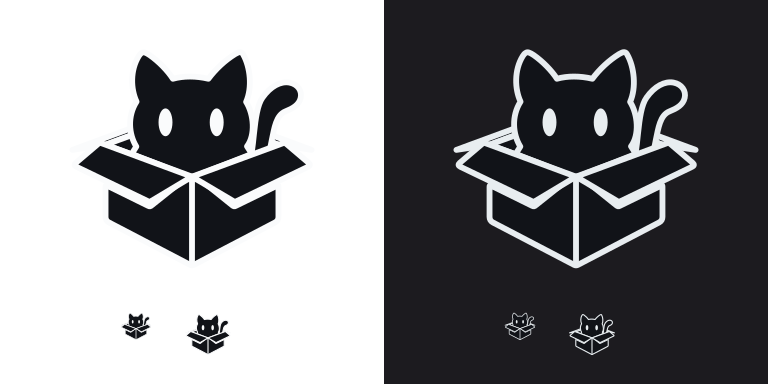

# 项目 Logo

正式母版为 `assets/branding/logo.svg`，采用猫咪出箱 demo 的运行态静止造型：
单条中央竖线与前盖交点相连，后盖向后翻落并按透视缩短，箱口后壁补全，卷尾从箱内伸出。
母版来自 `demos/box-cat-demo/resources/images/logo_completed.svg`，保留完整图层与透明背景。
动画工程仍独立运行，不连接主程序内核或代理。



## 更新流程

编辑母版后，在仓库根目录运行：

```bash
python3 scripts/generate-branding.py
python3 scripts/generate-branding.py --check
```

生成器需要 Python、CairoSVG 和 Pillow；普通构建直接使用仓库中的生成资源，不需要这两个 Python 包。
`--check` 比较生成结果且不写文件；不同版本的栅格化依赖可能产生不同 PNG 编码，更新时应一起审阅图像。
仅更新托盘可用 `bash scripts/generate-tray-icons.sh`，同样支持 `--check`。

生成目标：

- 界面：`resources/images/clash_flux_logo_vector_{dark,light}_current.svg`，透明、多色 SVG，按 ThemeSpec 选择，不加 Tint。
- 通用透明图及 Windows 安装器：`resources/images/clash_flux_logo.png`。
- Linux / Windows / macOS 应用图标：`assets/icon.png`、`assets/icon.ico`、`platform/macos/AppIcon.icns`。
- 托盘：`assets/tray/logo.svg` 与 `resources/images/tray_*.png`，保留默认 / TUN / 系统代理的状态色和 1x / 2x / 3x 尺寸。
- Android：透明 adaptive mascot 和五档白底 launcher 图标；快捷磁贴猫爪独立保留。
- 现有 iOS AppIcon 资源同步更新；iOS 支持仍按项目 TODO 暂缓。

界面与应用图标使用同一几何与图层，只调整配色和画布留白。旧主 PNG、桌面图标和托盘 SVG
保存在 `legacy/`；原 refined、single_seam、unified 及历史试验资源继续保留。

## 安全预览

正式深浅 SVG 会同步为独立 demo 的 `project_logo_dark.svg` / `project_logo_light.svg`，字节与正式资源一致。
下面的命令只启动独立预览窗口，显示两种主题及 32 / 48 / 64pt 尺寸，不启动主程序：

```bash
./demos/box-cat-demo/run-demo.sh --brand-preview
```

修改后仍需执行仓库规定的主目标编译、版本验证和 `git diff --check`。
各平台安装图标的资源检查不代替对应平台的打包验证。
