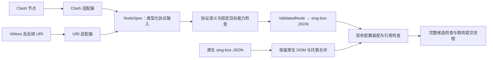

# 协议转换中间模型重构计划

日期：2026-11-15。状态：**P0–P6 本轮范围已落地并通过本机 Linux/Android 验证：12 类 Clash 节点共用统一模型，七类 URI、官方样例证明的历史 SS 与能力一致性门禁已接入**。其它历史格式仍按必要样本另行评估，Windows/macOS 与真机验收未完成。按用户后续指示，HUI/CodeEditor/Media 已同步固定更新；内核和应用版本保持。

研究基线为 Clash-Flux `894a8080455e066bb63811deb5097554e4c62cdd` 加当前未提交工作区（含规则加载及二维码改动），内核固定 sing-box 1.14.4。实施前重新记录实际代码快照与字段基线，不能把本计划当作已交付能力。

后续方向已确定为[同仓转换子项目](converter-project.md)：按独立项目维护转换能力，当前保留同一仓库、模块和构建，先整理源码与依赖边界。P0–P6 的语义重构已完成，独立库/API/资源契约和外部消费验证仍是后续工作，不因目录归拢宣称独立 SDK 已交付。

## 目标与范围

将格式解析、协议语义、目标能力检查和 JSON 生成分开。Clash YAML 与节点链接分别解析为中立的协议模型，再统一生成 sing-box 配置；新增 URI 不再先装配 Clash 协议节点。
迁移期先保持现有 12 类 Clash 出站的接受/拒绝范围、默认值、引用、输出与保真度，再扩展输入格式。详细支持边界继续只维护在[保真度契约](singbox-layers-and-fidelity.md#41-出站协议clash-转换覆盖-12--15-个代理协议类型)，本计划不另建第二套能力矩阵。

| 纳入重构 | 保持既有边界，本轮不重构 |
| --- | --- |
| SS、VMess、VLESS、Trojan、HY1、HY2、TUIC、HTTP、SOCKS5、SSH、AnyTLS、Snell 的当前已支持子集 | shadowtls / tor / naive 等新增协议能力，WireGuard / OpenVPN endpoint，PPTP 和系统连接 |
| 凭据、TLS / Reality / uTLS、V2Ray 传输、UDP 编码、SS 插件、QUIC 参数和拨号参数 | DNS / 路由 / 策略组的整体中间模型、UI 编辑器、协议导出、多内核后端 |
| 主订阅、provider、桌面次来源中已存在的节点转换入口，现有 VMess 节点输入 | 下载器、数据库/schema、文件提交协议、来源身份规则和手机编排能力 |

原生 sing-box JSON 继续使用现有 DOM 路径，保留原生字段及数值类型，只做已定义的托管合并。不能为了统一而将完整原生配置往返到不完整模型；未来如需从原生 JSON 提取节点，须单独证明完整保留与引用处理。全局规则、组和 DNS 仍消费现有最终出站及 tag 映射。

## 参考项目：借鉴与取舍

固定研究快照：[SubConverter-Extended `144f7c6`](https://github.com/Aethersailor/SubConverter-Extended/tree/144f7c6bf6f7dd3da3d280730914b77f9df54631)。
其 [Proxy](https://github.com/Aethersailor/SubConverter-Extended/blob/144f7c6bf6f7dd3da3d280730914b77f9df54631/src/parser/config/proxy.h) 为传统目标提供公共字段和大量协议字段；`CanonicalProxyJson` 又保留 Mihomo 的完整映射，Clash 输出以此为准，旧字段是兼容投影。
[ProxyNode](https://github.com/Aethersailor/SubConverter-Extended/blob/144f7c6bf6f7dd3da3d280730914b77f9df54631/src/parser/mihomo_bridge.h) 是桥接载体，因此该项目并非所有输入都经过一个完全中立、无损的统一模型。

- 借鉴解析器与生成器分离、保留字段类型和来源信息、编码兼容案例；完整原文与可执行投影分开保存。
- 不照搬将所有协议字段堆在一个大结构中的方式；采用公共信息加协议专用的 tagged union，避免 SS 密码与 SSH 私钥等不相关字段同时成为有效状态。
- 不把 Clash/Mihomo JSON 或任意字符串 map 当作协议模型的逃生通道。未知字段仍在来源中保留，明确诊断，未经审查不参与生成。
- 不接入公共转换服务、Go/CGO 或 Mihomo 运行依赖；协议规范和固定 sing-box 能力仍是依据。

## 实施前代码与职责拆分

| 实施前位置 | 原职责与耦合 | 迁移责任 |
| --- | --- | --- |
| `src/singbox_proxy.inc::convertProxy` 及 `append*` | 同时读 YAML、检查字段、应用默认值、记账和写 JSON | Clash 节点适配器 → 协议校验/能力映射 → sing-box 生成器 |
| `src/singbox_node_subscription.inc` | 识别包装，解析 VMess JSON，装配临时 Clash 节点、选择组和 MATCH | 保留有界解包；协议直接生成节点模型；默认选择策略单独装配 |
| `src/singbox_compile.inc::compileClashDocument` | 主来源节点编译、组/规则集成、失败策略 | 继续编排；通过统一入口消费节点结果和诊断 |
| `src/singbox_proxy_provider.inc::appendProxyProviderNodes` | 集合校验、筛选、逐项转换、成员发布 | 保留筛选及事务边界，通过同一节点入口完成协议转换 |
| `src/singbox_context_dns.inc::Context` | 编译结果、来源指纹默认值、tag 注册、诊断 | 保留应用编译上下文；只向协议处理传入不可变的来源/目标上下文，不让模型持有运行状态 |
| `src/singbox_sources.inc`、`validateOutboundDependencies` | 来源命名空间、对象目录、依赖闭包与环检查 | 先保留现有最终 JSON 上的检查和引用重写，避免同时重写整张配置图 |
| `src/singbox.cpp` 的 Validate / Inspect / compileConfig | 格式分流、只读检查、目标目录、运行配置出口 | 保持公开调用契约；为节点列表分流接入新解析结果，不将只读检查当作候选批准 |

协议实现现归入 `src/converter/protocol/{model,clash,validate,singbox}.inc`，节点输入归入 `src/converter/input/`；仍在 `clashflux.singbox` 的同一私有实现域编译。格式字段门控归适配器，装配层的 `emitProtocolNode` 是协议校验、诊断发布和生成的共同出口。上表记录迁移前位置，当前源码导航见[转换目录](../src/converter/README.md)。
模型不导出给 UI，不把 YAML / nlohmann / Glaze 放进新的公开 DTO 接口；解析和 JSON 生成留在实现单元。既有 `singbox.cppm` API、CLI 与 store 调用保持，暂不新建独立公共模块或序列化格式。

## 目标数据流

这是节点协议模型，不是整份配置 IR。当前 12 类协议已完成迁移，没有旧协议转换器或运行时双编译；模型校验失败不能尝试另一条路径。

## 模型约定

| 实现部分 | 内容与约束 |
| --- | --- |
| `NodeOrigin` | 实际最小结构为来源 ID 和来源内原名；URI 行号/provider 名在格式层错误中定位，不复制进未被消费的模型字段，不包含原始 URI/凭据。外部对象身份仍按既有来源 ID + 种类 + 原名，不引入伪稳定 UUID |
| `NodeSpec.server` / `port` | 拥有型服务器字符串和可选端口；HY1/HY2 的 ports-only 与端口范围由其专用结构表达，不强迫每个节点拥有一个生效的单端口 |
| `ProtocolOptions` | `std::variant` 分别承载当前 12 类已支持协议的字段；认证、私钥、混淆、插件、窗口与会话参数各归对应类型，不能靠默认空字符串区分协议 |
| `TlsOptions` | TLS 启用意图、证书验证、SNI、ALPN、uTLS、Reality 与 disable-SNI；与协议组合校验。TCP TLS 与 QUIC TLS 能力不同，不能共享一套默认开关 |
| `TransportOptions` | 普通传输、WS、HTTP、gRPC 的 variant；完整保留已接受的 path、headers、host 列表、early-data 和 service-name 语义。未知传输没有默认 TCP 分支 |
| `DialOptions` | 来源内 detour 引用、bind-interface、routing-mark、TFO、MPTCP；尚未解析的名称引用先保留，交完整依赖图检查，不私自去掉引用 |
| `SourceDefaults` / `TargetCapabilities` | 实际为来源指纹默认及目标 bind-interface/routing-mark 能力；固定内核字段能力按依赖锁实现于校验/生成器，不新增运行时版本猜测。不从活动主订阅、宿主 OS 或 UI 状态推导另一来源的值 |
| `NodeDiagnostic` / 结果 | 结构化失败或近似原因及字段路径，连接既有 FidelityScope / Fidelity / sourceId；格式错误、未支持语义和运行检查失败分开，保持已有输出顺序和信息 |

解析结果与 `ValidatedNode` 区分：前者表示输入中实际声明的值，后者表示完成协议/目标校验后可生成的映射；JSON 生成器只消费后者，不再读原始 YAML 或重新猜默认值。名称和字段以首次纵向迁移时的真实最小需求定稿，不先建设通用 schema 框架。

### 缺省、原文和类型

- 未提供、显式 false、显式 0、空字符串和空列表不能合并为同一状态。对语义相关字段使用 optional/枚举和精简来源标记；异常类型返回诊断，不能在 DTO 中变成默认值。按字段保留当前对 null 的行为，不能机械地把所有 null 当缺省。
- 格式适配器处理别名、重复键、旧字段优先级和来源默认，并记录冲突。Clash 的 `servername` / `sni`、新旧 WS 字段、gRPC service-name、VMess/VLESS UDP 编码优先级按既有契约处理，不能因统一字段而消失。
- 凭据、私钥、path、headers 等拥有型保存，保持原文、顺序和合法空值；不 trim、不对完整订阅做 URL 解码、不把全部值转字符串。URI 百分号只在原始组件边界解码一次，重复 query 在处理前不得丢失。
- 单位转换和范围验证有明确归属：HY1/HY2 的 Mbps/MBps、秒数范围、端口范围及窗口保持当前语义；保留产生 approx 所需的来源证据，不因较早归一化而省略诊断。
- 原始 profile 文件仍是权威来源，模型只是单次准备中的拥有型值；不写回规范化 YAML，不把协议模型持久化为第二份权威配置。

### 解析、能力映射与装配的边界

- 格式适配器检查结构、字段白名单、别名和格式特有默认；模型校验检查协议内组合；目标能力映射决定 exact/approx/unsupported 与平台限制；生成器只写已验证字段。每个语义差异只记一次账，并桥接既有 warnings 投影。
- 完整原生 JSON 不借助任意 `NativeJson` 协议 variant 绕过校验。原生直通在文档分流边界独立存在；本次未建模字段不能借扩展字典悄悄进入生成配置。
- 相同格式、来源默认和目标条件必须得到确定结果。主/次来源和 provider 不共享未经上下文核对的默认值；首轮不新增 IR 缓存。未来缓存至少区分输入修订、来源默认、目标能力及编译器语义版本，沿用现有准备版本检查。
- 重构不收紧或放宽既有接受范围。新发现的解析漏洞或映射错误单列修复、预期变化和回归，不混在“结果等价”的迁移中。

## 必须保持的入口差异

| 入口/行为 | 重构时的要求 |
| --- | --- |
| 普通 Clash 主订阅 | 保持当前单条拒绝并记账的行为，以及坏 MATCH/detour 等引用导致完整失败的规则；不能擅自改为所有坏条目一律整份拒绝，也不能静默放行 |
| 节点 URI 列表 | 任意未知/坏条目、重名或协议转换失败拒绝整份候选，保留合法前缀也不能提交；8 MiB、4096 节点与现有 VMess 单项上限保持 |
| HTTP/file/inline proxy-provider | 保持集合校验、筛选顺序、类型别名和成员次序；最终参与转换的节点失败时拒绝集合。URI 集合先做的全表语法检查仍保留，不把重构变为筛选语义改变 |
| 来源内默认与依赖 | 全局指纹仅限本来源，节点显式值优先；detour 可向后引用，组的全部候选、DNS 和命名空间继续完整检查，不能只检查当前选中成员 |
| TLS / 平台 | 强制 TLS 协议拒绝显式关闭；QUIC 不继承 TCP uTLS；Android 不因 `__linux__` 获取桌面 routing-mark 能力；detour 忽略物理拨号字段时继续记 approx |
| 只读规则投影 / 对象目录 | 节点列表的默认 selector/MATCH 策略由独立策略装配辅助函数生成；保持原名称、顺序、默认出口和策略 approx。只读解析不下载、不启动、不代替完整候选检查，不能重新构造协议 YAML 绕回旧转换器 |

## 分批迁移与退出条件

P0/P1 验证见[首批证据](evidence/2026-11-15-protocol-p1.md)，P2 及 HUI 更新见[P2 证据](evidence/2026-11-15-protocol-p2.md)，Shadowsocks 迁移见[P3 证据](evidence/2026-11-15-protocol-p3.md)，剩余六类协议迁移见[P4 证据](evidence/2026-11-15-protocol-p4.md)，入口收敛与核对见[P5 证据](evidence/2026-11-15-protocol-p5.md)，SS 输入扩展见[P6 首批](evidence/2026-11-15-protocol-p6-ss.md)，VLESS/Trojan 见[P6 第二批](evidence/2026-11-15-protocol-p6-vt.md)，HY2/TUIC/AnyTLS 见[P6 第三批](evidence/2026-11-15-protocol-p6-secure.md)，历史 SS 和能力门禁见[P6 收尾](evidence/2026-11-15-protocol-p6-final.md)。各批有本机 Linux/Android 记录，Windows/macOS CI/实机覆盖仍待补齐；其它历史格式和未列字段未开放，不能将协议名称理解为完整字段支持。

| 阶段 | 实施内容 | 本阶段通过条件 |
| --- | --- | --- |
| P0 基线 | 记录当前 12 协议的正/反样本、JSON 和保真度结果；补齐有风险的交叉组合 | 能独立断言预期，不仅依赖新旧实现互相比对；当前生产路径不改 |
| P1 首个纵向切片 | 私有模型、诊断桥接和目标上下文；HTTP/SOCKS5 从 Clash 解析到生成全链路迁移 | 主订阅与 provider 同时走统一节点入口；缺省/显式空凭据、TLS、UDP 和 detour 等价，模块/各目标编译通过 |
| P2 VMess/VLESS/Trojan | 共享 TLS、传输和 UDP 编码；现有 VMess JSON URI 直接填充模型，取消该路径的临时 Clash 协议节点 | 原有包装、net=tls 兼容、TLS/传输、选择组、规则投影及目录结果保持；不新增 VLESS/Trojan URI 入口 |
| P3 Shadowsocks | SS 凭据、已支持插件和 UOT 迁移 | 默认 host/path/mux、SIP003 转义、显式 false、非法组合拒绝及凭据保留完整等价 |
| P4 剩余已支持协议 | 依次迁移 HY1/HY2/TUIC、AnyTLS/Snell/SSH；按协议拆小批 | 不共用错误的认证/TLS/QUIC 默认；保留带宽/窗口/跳端口、SSH 认证顺序近似、Snell 版本拒绝等已有边界 |
| P5 收敛 | 删除已迁移旧节点实现，核对所有解析/编译/只读/次来源入口 | 已支持节点只有一条协议语义及生成路径；未留“失败回退旧实现”，主目标/全部必跑回归及目标平台记录齐备 |
| P6 输入扩展（本轮完成） | SS、VLESS/Trojan、HY2/TUIC/AnyTLS、已有 VMess、公开样例证明的历史 SS；统一输入登记与门禁 | 适配器直接构造模型，明确字段子集、诊断与固定内核证据；清单与生产分流、独立样例、账本及实际内核版本/revision 一致；其它格式按[扩展计划](node-subscription-plan.md)另行评估 |

首次实施任务为 P0 加 P1（已完成）：建立等价样本、定义最小模型和私有接口、迁移 HTTP/SOCKS5 及其 provider 调用，验证通过后再迁移复杂 TLS/传输。P0 的差分对照只用于测试或冻结样本，正式环境始终按协议单路径执行。

首批交付物为：现有入口的基线样本清单、最小 NodeSpec/ValidatedNode 和诊断接口、HTTP/SOCKS5 的 Clash 适配/校验/生成实现、主订阅与 provider 的接入回归，以及实际构建/内核检查记录。首批不实现其他 URI、不升级依赖、不迁移数据库，也不导出新的公共 API。
未达到等价条件时不切换该协议的生产入口；后续发现回归则按批次回退源码改动，不清理订阅/缓存、不重建数据库、不让运行时自动改走旧解析器。

## 验证与交付要求

| 检查层 | 实施时的重点 |
| --- | --- |
| 协议语义 | 扩展 `tests/test_singbox.cpp` 的 testProxyValues、testProxyUdpOptions、testShadowsocksPlugins、testHysteria1、testSsh、testNodeSubscriptions 等生产入口案例；保持数组顺序、字段存在性、数值类型和凭据字节，不只比较 JSON 是否可解析 |
| 保真度 | 正常/近似/拒绝的分类、subject/sourceId、原因和 warnings 投影对照；失败仍保留已有账本，不因流水线分层重复或漏记 |
| 组合与入口 | 主/次来源同名、全局指纹隔离、provider 筛选/重名/失败、include-all 排序、detour 缺失/成环、规则目标、原生 JSON 未知字段/大整数保留；目录和只读投影不变成运行批准 |
| 固定内核 | 每批新增或迁移样本用当前固定内核 check；运行 proxy_provider_runtime、group_expansion_runtime 及相关 DNS/路由回归验证已存在的真实转发路径。check 不等于各协议真实服务端握手，缺少服务端的协议逐项注明未覆盖 |
| 数据与运行 | 通过生产 prepare/导入/刷新检查失败留旧、文件/引用保护和迟到结果拒绝，按需执行 persistence、resource_management_runtime、personal_rule_sets_runtime；单元解析测试不替代真实提交检查 |
| 平台与构建 | 各批构建主目标和 test_singbox，执行版本检查及 diff 检查；相关分支核对 Linux/Windows/macOS/Android 编译与平台能力，未执行的平台列为未覆盖。P5 前执行完整桌面必跑门禁，Android 不以桌面门禁代替 |
| 性能与资源 | 同工具链/配置/输入记录解析、映射、生成及候选检查开销；大节点列表检查峰值内存、取消和复制次数，避免每层复制全文/JSON。只读规则页不因引入协议模型重新做完整配置编译；不预设提速结论 |

实施批次的基础命令为 `cmake --build build --target clash-flux test_singbox`、`./run.sh --version`、`git diff --check`，具体回归遵守[测试技能](../project-skills/clashflux-test/SKILL.md)。
完整门禁前构建全部测试目标，再执行 `ctest --test-dir build --output-on-failure --no-tests=error -L clashflux-required`；不能将未重建的旧测试产物当作新实现证据。每批记录实际快照、命令、结果及未覆盖范围，不引入生产运行时迁移开关或持久化 IR 版本。

## 完成定义与本轮状态

协议重构完成须同时满足：当前 12 类已支持节点经格式适配器进入类型化模型并单一路径生成；主订阅/provider/次来源及现有 VMess URI 已接入；原生 JSON 保真、错误策略、账本和引用行为保持；旧节点转换实现删除；构建及相应回归有证据。
URI 新格式的支持是后续独立交付，不与重构完成混为一谈。已有四份私有协议实现文件，模型包含 HttpOptions / Socks5Options / VmessOptions / VlessOptions / TrojanOptions / ShadowsocksOptions / Hysteria1Options / Hysteria2Options / TuicOptions / AnyTlsOptions / Snell4Options / SshOptions 与独立传输 variant；端口可选，HY 的有效端口范围单独表达。Clash 字段门控继续共用，解析器在字段阶段调用独立校验以保持诊断先后关系，生成器仅消费 ValidatedNode。
P0 冻结 106 组基线（覆盖 12 类协议）；P1 迁移 HTTP/SOCKS5 的主订阅/provider 入口，并保留较晚 YAML 异常前的诊断。P2 新增 94 组 Clash 与 17 组 URI 冻结样本，迁移 VMess/VLESS/Trojan；现有 VMess URI 直接填充模型，选择组/MATCH 策略单独装配，不再装配协议 YAML。
P2 的 6000 组 Clash 与 3000 组 URI 差分、74 份固定内核检查、完整桌面必跑门禁 32/32、Android Java/arm64 APK 构建及 Linux 原生首页图表检查均通过。4096 条合成 URI 的 Debug 对照输出相同，实际耗时/内存记录在本轮证据，不当作 GUI/Release 性能。
P3 另冻结 121 组 Shadowsocks 样本，迁移凭据、simple-obfs、v2ray-plugin 与 UOT；增加本地双内核 AEAD / SS 2022 TCP/UDP、UOT v1/v2 和显式禁用回归。格式默认与插件结构检查留在 Clash 适配器，模型校验有效组合，SIP003 只在生成器编码一次。338 组冻结样本、6000 组本轮差分、124 份内核接受/1 份预期拒绝、9 条本地数据流、完整必跑门禁 33/33 及 Android Java/arm64 构建均通过。
P4 分批迁移 HY1/HY2/TUIC 与 AnyTLS/Snell/SSH，删除对应旧节点生成和 append 辅助实现；当前 12 类协议统一走模型校验和生成。新增 289 组冻结样本，累计 627 组；12000 组组合差分全部一致，固定内核 244 份接受/1 份既有空 SS 密码预期拒绝。新增必跑 protocol_runtime 的 14 条本地 TCP/UDP 数据流及 TLS 身份拒绝，另完成本地 SSH 三种认证转发及主机公钥拒绝的手工补充检查；完整必跑门禁 34/34 和 Android Java/arm64 构建通过。
P5 将 Clash 字段门控归入格式适配器，统一主订阅/provider 的协议校验、来源默认解析、诊断发布与生成出口；18 组跨入口样本核对 12 类协议及现有 URI 的文档/规则检查、目录、HTTP/file/inline provider、次来源和取消。单列修复 provider 漏记 VMess net=tls 近似说明，过滤掉的节点仍不记账。627 组冻结样本未变，27000 组主编译差分一致；原生未知字段/数值类型保留，完整门禁和 Android 构建见[P5 证据](evidence/2026-11-15-protocol-p5.md)。
P6 首批按解析扩展计划接入公共 URI 拆分/单次解码、SS SIP002 及 SS/VMess 混合列表。SS 插件 host/path 改为可选以保留格式差异，既有 Clash 默认与 627 组冻结结果保持；provider URI 按真实 ss/vmess 类型筛选。49 组 SS 正向、58 组拒绝、原生配置及本地转发、Prepare 失败留旧的命令和边界见[P6 首批证据](evidence/2026-11-15-protocol-p6-ss.md)。
P6 第二批直接适配 VLESS/Trojan URI，独立定义 TLS 与传输默认、SNI/Host、完整凭据及 Reality/Vision；四类 URI 可混合，provider 按真实类型筛选。43 组正向、111 组拒绝、固定内核配置与实际转发、Prepare 失败留旧和平台构建见[P6 第二批证据](evidence/2026-11-15-protocol-p6-vt.md)。
P6 第三批适配 HY2/TUIC/AnyTLS URI，公共语法显式选择默认端口、可选认证和 HY2 端口集合，保持旧格式门控；TUIC UDP 模式加入类型化模型，Clash 白名单不扩大。59 组正向、177 组拒绝、七协议混合入口、固定内核配置和真实转发、Prepare 失败留旧、Android 构建见[P6 第三批证据](evidence/2026-11-15-protocol-p6-secure.md)。
P6 收尾新增官方样例证明的历史 SS 整串 Base64 适配，密码不做百分号解码，独立分流、明确失败；18 组正向/27 组拒绝和两个普通/provider 实际转发场景通过。注册表驱动 scheme/默认名/provider 类型，公开拥有型能力 API；8 种格式、9 份独立样例及必跑 node_input_catalog 核对字段、账本、固定来源和实际内核，拒绝能力漂移，见[P6 收尾证据](evidence/2026-11-15-protocol-p6-final.md)。
P0–P6 本轮范围已完成本机验证，其它历史格式继续按样本评估，旧 VMess 变体维持拒绝。Windows/macOS 构建、Android 真机扫码/VPN、定时多端口跳转、全部协议参数和远端互通未覆盖；详细命令、源码指纹和边界见各阶段证据与[L1/L2/L3 状态](l1-l2-l3-status.md)。
