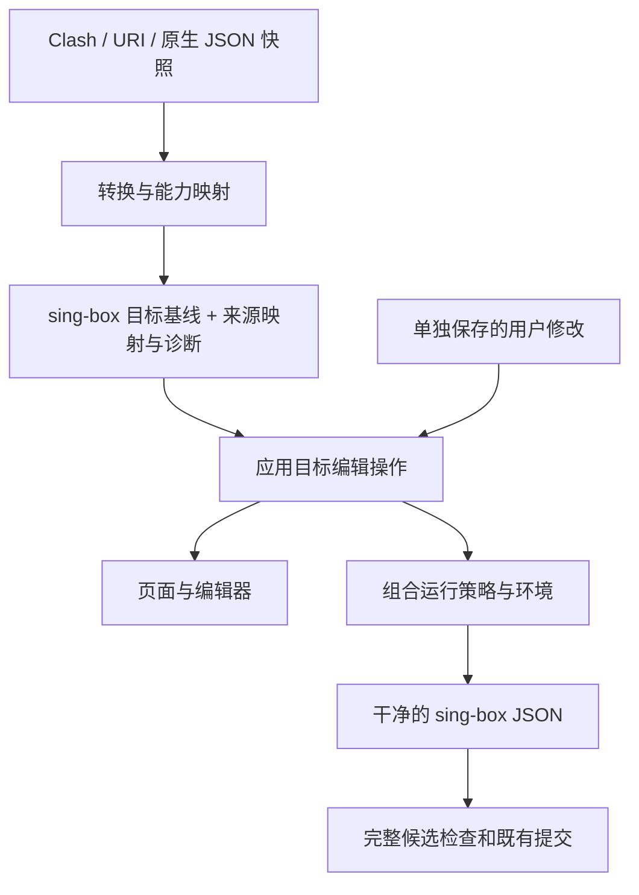

# sing-box 目标工作模型与转换产物规划

日期：2026-11-16。状态：**R0/R1 已完成，R2 已接入共享目标视图、编辑目录和预生成，预览仍待贯通**。基线为 `f08cde6` 加已有 Android HTTP 配置/文档工作区；本轮只读页已消费目标模型，旧个人修改兼容重放；编辑、保存、预览和运行仍走既有契约。证据见 [R0](evidence/2026-11-16-target-r0.md)、[R1](evidence/2026-11-16-target-r1.md)、[R2](evidence/2026-11-16-target-r2.md)和[预生成接入](evidence/2026-11-16-target-r2-prewarm.md)。

归属：[同仓转换子项目](converter-project.md)。按用户明确的 sing-box 优先方向，转换器主要产出接近 sing-box 的目标配置，界面基于转换结果交互。中间层定位为“带管理信息的 sing-box 工作模型”，不再建设完整的、可编辑的来源语义模型。文件名保留以维持已有文档链接。

## 目标与当前差距

当前协议有 NodeSpec，规则已有目标模型、应用级共享视图和完整候选短期缓存；普通只读页与编辑目录消费转换结果，导入/刷新后的视图在后台预生成。旧编辑投影、预览和运行编译仍有各自处理上下文。当前行为见[个人规则契约](subscription-personal-rules.md)，测量见[规则页性能](rule-page-performance.md)。

目标是先转换再交互：来源版本变化后生成目标基线；规则页、编辑器与配置生成共享该基线。页面重进、切换展示方式、个人修改不触发来源格式重解析；运行设置变化复用不受影响的目标基线，再做必要的组合与检查。以减少入口重复和统一交互为目的，不继续为各页面维护独立来源解析器。

首次转换仍有成本。内存产物只解决同进程复用，应用重启后需要重建或加载磁盘产物；即使落盘也有读取、解码及版本核对成本，不承诺零解析或零延迟。

## 数据流与职责

| 部分 | 职责与边界 |
| --- | --- |
| 转换器 | 解析输入、按实际 sing-box 能力生成目标对象及诊断，提供必要的来源对应关系；协议私有 NodeSpec 等转换内部模型可继续使用 |
| 目标工作模型 | 管理目标对象、启用/禁用、新增/替换、编辑冲突及身份；内容字段贴近 sing-box，管理信息与内核字段分开 |
| 应用存储与任务层 | 保管原订阅、用户修改和派生产物，负责版本、后台转换、缓存预算及原子提交；核心不获取 UI/数据库/Runtime 单例 |
| 界面 | 读取目标快照，以对象身份提交操作；不为展示规则重新解析 YAML/URI，也不自行拼写最终运行 JSON |
| 运行组合与生成 | 加入全局策略、来源命名空间、模式、TUN/监听等运行事实，输出内核可接收的 JSON；目标产物不是候选批准凭证 |

原订阅仍作为输入、刷新基线和失败恢复依据保存，用户修改独立持久化；转换目标是派生基线，不能反写原订阅。日常界面维护目标对象，不再保留另一套完整来源规则语义树。原文高级编辑入口继续编辑原文并触发新版本转换。

## 工作模型的内容

工作模型包含接近 sing-box 的内容与旁挂的结构化管理信息，不使用注释保存机器状态，也不向内核 JSON 添加自定义字段。内部名称和接口在首次迁移时定稿，不提前承诺稳定 SDK/ABI。

- 目标内容：规则的原生条件/动作/出口引用、相关 rule_set 声明，以及编辑所必需的目标对象目录。用明确的拥有型类型/访问接口表达已支持能力，字段结构优先贴合 sing-box，不建设多后端通用规则语言。
- 管理信息：对象身份、来源版本、必要的来源定位/转换分支、启用状态、用户新增/替换/禁用、编辑权限、冲突和保真度。界面展示的是当前编辑后的目标结果，禁用对象仍保留在工作模型中，生成时排除。
- 原生内容：sing-box 原生 JSON 的未知字段、复杂对象和数值类型继续完整保留，未实现编辑的部分只读；内部可持有原生 DOM，公开 DTO 不暴露 nlohmann/YAML 类型。不要求把原生完整配置往返经过不完整的类型集合。
- 未生成内容：不支持的来源条目不进入可编辑目标对象表，只保留定位及诊断。approx/unsupported、整条拒绝/整份候选失败沿用既有契约，不能删掉坏子条件扩大匹配，也不能为得到目标结果而静默补 DIRECT。
- 对象关系：以显式目标引用处理，最终运行 tag 可在组合阶段绑定。数组索引不作为编辑身份；对象显示名、跨来源命名空间和运行 tag 不混用。

目标基线保持来源转换的原生默认和规则顺序，与运行组合注入的全局规则、模式前置动作等分开。不能直接把现有完整运行 JSON 当成基线，再重复注入个人/全局规则。目标视图和当前内核已应用规则分开标识，保留既有预览、保真度与运行追溯的含义。

## 目标编辑与刷新

界面通过目标对象身份提交启用/禁用、修改、删除个人新增项、恢复、插入和排序等已有操作；现有只读规则、桌面/手机能力和编辑子集不因内部模型调整而自动扩大。先从规则交互及最小出口目录迁移，后续再按需求扩展整个目标配置，不同时重构所有 DNS/组/provider。

用户修改存为对目标基线的明确操作，不直接覆盖派生基线，也不只保存编辑后的最终 JSON。订阅刷新后先转换新基线，再匹配重放修改：唯一可确认的对应关系才继承，缺失、歧义或目标能力变化明确报告冲突，保留旧修改及可恢复配置，不能按新数组位置误套操作。

来源到目标可能一对多、多对一或没有输出；必须记录足够的转换分支映射并定义对应对象的操作粒度，不能用来源行号或内容哈希凭空承诺跨刷新稳定身份。只保留完成刷新匹配所需的信息，不恢复一套来源编辑树。

现有持久化个人规则绑定源锚点，不能直接换成目标 ID 就宣称兼容。R0/R3 须逐种 operation 明确等价转换、冲突和撤销行为，特别是一对多、重复规则、隐式兜底和失效出口策略；不能可靠映射时不得静默丢弃旧修改。新旧格式迁移需单独版本设计与失败保护，不顺手重写数据库或旧记录。

## 产物生成、复用与失效

转换在导入/刷新/原文编辑后的应用任务域准备；保存原文、后台准备、活动来源更新的先后与失败保护继续按当前数据契约执行，不能为预生成改变事务。读取页面只获取已发布快照；缺少产物时请求一次后台生成，显示真实准备/错误状态，不在页面组合期执行下载或转换。

转换基线可先使用不可变内存快照。产物身份包含完整来源内容、格式、转换语义版本、实际目标能力和必要的转换默认/资源身份；摘要只作索引，路径和 mtime 不独立作为有效性证据。源相同而转换语义、平台映射或内核能力不同，不能沿用旧结果。

| 变化 | 预期处理 |
| --- | --- |
| 来源内容、转换器映射、目标能力或转换依赖变化 | 重建受影响目标基线，再重放修改与候选检查 |
| 用户修改变化 | 复用目标基线，重新应用操作，按需验证生成结果 |
| 运行模式、TUN/监听、全局策略变化 | 复用未受影响基线，重新组合/绑定；影响转换输入的部分按完整身份失效 |
| provider/原生规则集正文变化 | 根据真实依赖使相关结果失效；不能只看 URL/路径不变，不能沿用旧批准 |
| 页面重进、搜索/视图切换、流量统计变化 | 复用目标快照，不重复转换或来源解析；不因此新增当前页面没有的控件 |
| 应用重启 | 内存方案重新准备；持久化启用后校验并加载产物，失配则重建 |

应用按来源 ID、内容/修改修订和任务版本发布，保持同一输入单飞；取消、删除/重建、ABA 和旧任务晚到不能覆盖新快照。缓存淘汰不影响在用不可变对象；失败不能降成空规则成功。跨来源复用前证明身份、诊断和出口引用不泄漏，首批允许仅在同一来源内复用。

先统计原文字节、目标对象、管理信息、页面投影及现有候选缓存的总常驻/峰值内存，再定共同预算和淘汰策略；不为每层各留一份无限制副本。编辑一个对象不应无条件复制整份大配置，界面不在组合期深拷贝规则表。

## 实施阶段与退出条件

R0 已完成调用图、42 份独立契约与冻结观察；R1 已建立来源目标捕获。R2 本轮完成应用任务共享、只读目标视图、旧修改重放、目录复用、失效及闲置预算。预生成已接入同一应用服务和预算，初次 hydrate 只预载默认可用来源，连续接受版本合并，资源准备完成后推进；预览消费和编辑/运行共用模型仍待贯通，不以本轮代替 R2 全部退出条件。阶段编号与协议 P0–P6 区分。

| 阶段 | 工作与交付 | 退出条件 |
| --- | --- | --- |
| R0 基线与契约（已完成） | 盘点现有转换、规则展示/编辑/预览/运行入口；区分目标基线与运行注入，设计目标对象身份、分支映射及旧个人修改兼容方案 | 源码快照、调用图、独立预期、转换次数/内存基线与支持/冲突矩阵齐备；不增加字段、编辑或平台能力 |
| R1 目标工作模型（已完成来源基线捕获） | 将现有转换结果包装为接近 sing-box 的拥有型目标对象和独立管理信息，先覆盖规则与最小出口目录；本阶段显式捕获未叠加修改的主来源，旧修改仍走原路径 | 原生内容/数值、顺序、默认、approx/unsupported 及完整错误行为保持；未生成项不伪装成目标对象 |
| R2 共享转换产物（已完成只读/目录/预生成，预览待贯通） | 应用后台生成并持有不可变目标基线；规则只读页、目录和预览逐步消费转换结果，实施身份、单飞、失效与总预算 | 生产入口计数证明页面重进无来源解析，编辑/运行设置变化按表复用；过期发布、失败重试、删除/ABA 与淘汰验证通过 |
| R3 目标编辑与运行贯通 | 界面提交目标操作，验证旧修改兼容/必要迁移；同一工作模型驱动列表、编辑预览与运行组合 | 对象映射、冲突/撤销、刷新留旧、持久化重开和候选失败保护通过；原生检查与资源检查不因命中跳过 |
| R4 收敛旧路径 | 移除界面专用来源规则解析和重复生成，保留转换器内部必要格式适配及有证据的快路径 | 各交互入口消费目标结果，只有一套生产转换语义；新旧完整产物/诊断等价，固定内核运行与完整门禁通过 |
| R5 重启加载与持久化评估 | 测量重启重建、目标产物读取/解码、磁盘/内存成本；有收益时另定格式和缓存生命周期 | 明确是否落盘的结论及证据；如实施，覆盖损坏/未知版本/失配重建和安全边界，不以“完全零解析”验收 |

建议按实际实现逐阶段在 src/converter 下整理目标对象、规则操作及生成职责，不提前建空目录、独立包或通用框架。仍使用现有模块，新增片段同步 AndroidLegacy 跟踪。现有 NodeSpec 等可继续作为转换内部模型，不因交互转向目标而先重写已验证协议实现。

## 验收与证据

先保持行为：独立冻结预期及保存的旧消费者比较完整 JSON、规则顺序、默认出口、sourceId、错误、warnings 和 exact/approx/unsupported 账本。测试生成结果与当前运行结果分别记录，不能只比较两个新入口或重录样例消除差异。

覆盖有效 MATCH 与后续条目、复杂逻辑和修饰符、重复/隐式规则、Clash YAML 引号/多行/锚点/别名、原生未知字段与整数/浮点边界；来源到目标一对多/多对一/无输出、未支持语义、provider/来源命名空间；个人操作、旧锚点兼容、刷新冲突和失败留旧。界面对象必须确实对应目标结果，不能把被转换舍弃的条目显示成已生效。

复用检查记录生产入口实际的来源读取/解析/转换、目标加载、编辑重放、运行生成与内核检查次数；分别测首次准备、页面重进、用户修改、运行设置/资源变化及进程重启。等待、IO、转换、投影和 UI 挂载分段记录，统计总内存，不把 Debug 合成耗时外推手机/Release，不设脆弱的墙钟 CI 阈值。

按[测试技能](../project-skills/clashflux-test/SKILL.md)验证：实现阶段运行 singbox、规则投影/跨入口和相关固定内核回归；保存/迁移运行 persistence，界面消费运行 page_transition / ui_resources。R3/R4 收尾完整必跑门禁及 Android native/Java 编译；平台/GUI/真机与发布验收独立记录。本轮 R2 的核心入口和共享 UI 模型回归、内存/次数见独立证据；预生成还验证真实数据库提交、版本文件与应用服务的首次打开读取次数；未覆盖完整页面 GUI 挂载或 Android 真机。R0/R1 证据不代替 R2 复用，R2 结果也不代替 R3 编辑/运行贯通验收。

## 后续磁盘产物边界

持久化是目标产物的编码选择，不决定工作模型的语义；JSON、CBOR 或其它格式到 R5 再按实际成本选择，不靠 JSON 注释存储启用/来源等机器状态。产物版本及身份覆盖模型 schema、转换语义、实际目标能力和依赖，运行投影另核对全部组合输入；不序列化 C++ 对象内存或承诺稳定 ABI。

应用专属缓存根、内容完整性、大小/条目/深度上限、私有凭据和独占暂存原子替换均需定义。损坏、未知/未来版本或失配只废弃对应派生缓存并从权威输入重建，不删除原文/用户修改、不重建数据库、不发布空配置；原文不可用时明确失败并保留可恢复旧计划。

磁盘命中不替代资源/平台/内核检查；不承诺所有规则转成 SRS、完整崩溃事务或跨版本永久复用。持久化前仍沿用当前原文与个人修改的保存契约。
