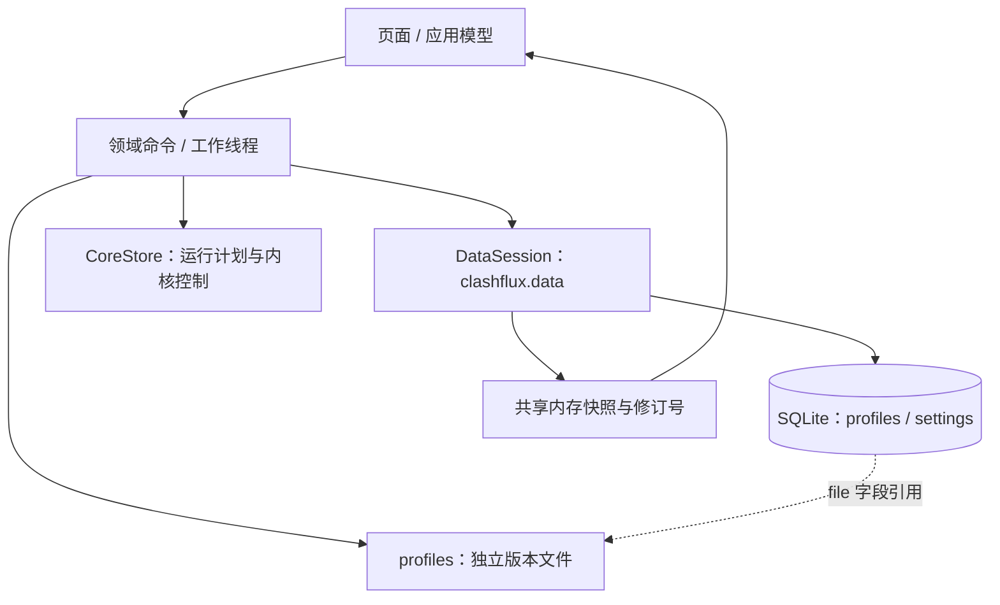
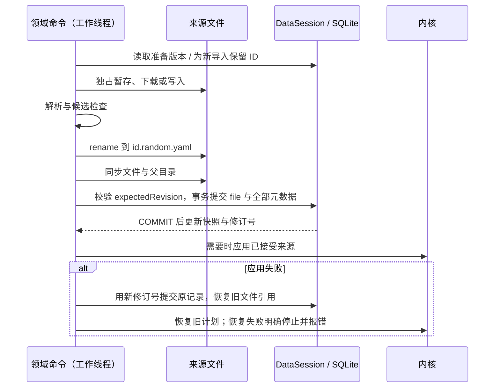

# 存储架构与重构进度

2026-11-11，工作区基于 v0.3.101；保留现有 SQLite schema v2 和全部来源文件。
这里区分已实现的阶段与后续目标，不把过渡接口当成最终设计。
2026-11-11 后续接入快速保存与后台资源准备，完整协议见[Provider 准备](provider-resource-management.md#保存后台准备与候选复用2026-11-11)。

## 已实现的分层

应用启动流程独立打开、hydrate 和关闭 DataSession。CoreStore 不再拥有数据库门面，
ProfilesStore 和其它领域消费者直接依赖数据会话；原 `clashflux.db` 和仅转发的 `Db` 已删除。
共享 Profile DTO 由 `clashflux.model` 提供，不通过运行控制层获取存储。
日志、生成的 core 配置、provider 缓存仍是各自用途的文件，不塞入 SQLite。

## 订阅内容的提交协议

刷新与原文编辑使用下列完整候选提交流程。原生连接导入和元数据编辑也等待
数据库确认，但原生连接不创建来源文件。

Windows 文件同步使用 `_commit`，rename 使用带 WRITE_THROUGH 的 MoveFileEx；POSIX
同步完整来源文件和父目录。SQLite 自身继续使用既有 WAL 和同步策略。
这里的文件协议保证引用只切到已完整准备的版本，不把数据库和内核说成一个事务。

本地首次导入仍允许先保存为未参与来源，激活时完整检查；刷新和编辑不能跳过候选检查。
新导入下载期间只有内存草稿，不发布半成品行。完整原文解析后即可提交已保存记录，
连接资源在应用任务域继续准备，状态与已保存记录分开；准备失败保留来源供查看、编辑和重试，
不把“已保存”说成“连接就绪”。原文传输/解析失败不插入记录。独立版本文件
与旧文件放在同一目录，保持相对 provider 路径的解析根。旧库的 `id.yaml` 引用继续有效。
刷新失败不覆盖旧文件；SQL 提交失败只可能留下未引用的新文件。当前刻意保留这些来源版本，
不做启动扫描或“修复性”删除；后续回收须独立设计引用核对和保留策略。

准备版本采用每个 ID 的单调修订号，删除也保留进程内版本，拒绝 ABA 和迟到完成。
桌面下载还在提交前核对原内容，拒绝下载期间外部改写来源文件。Android 更新把抓取前的
修订号传到 completeRemote。完整 HTTP 结果、流量、到期时间、首页和 file 在同一次行事务提交。
同类提交与兼容 flush 共用串行门，旧 flush 不能晚于新事务覆盖记录。

ORM 使用异步事务；旧领域命令仍为同步工作线程接口，由 DataSession 的应用作用域调度
适配器等待事务结果。适配器拒绝 UI 线程调用；协程消费者直接 await commitProfile。

## 尚未迁移的边界

第一阶段没有声称移除全部写后缓存。以下仍走原来的兼容写接口，最终目标是统一命令事务：

- settings KV、网络参数、全局策略、资源库与个人规则；需要支持多键及关联行的一次提交。
- 选择、排序、删除和原生历史配置转换；删除仍在事务确认且核对全部引用后清理指定文件。
- UI 的一秒快照泵、本地列表镜像；后续改为应用级变更通知，运行状态采样保留自己的频率。

后续顺序为：引入统一事务变更集 → 迁移这些领域命令与 UI pending/失败反馈 → 删除兼容
脏集合及定时 flush → 用变更通知替代存储轮询。必须在迁移每个调用者后再删除旧机制，
否则会把现有“操作完成”变成尚未确认的写入，或把 SQLite 等待搬回 UI 线程。

## 验证入口

`persistence` 增加真实 SQLite 写锁下的旧 flush / 新提交交错、提交前不可见、SQL 故障、
过期修订、ABA、工作线程适配与多来源重开。`resource_management_runtime` 使用生产 CLI
验证版本文件引用与旧文件保留，同时保留资源更新、外部改写拒绝及引用删除保护。
完整命令和本次实际结果见 [L1/L2/L3 状态](l1-l2-l3-status.md)。构建不等于断电故障注入或真机 VPN 验收。
